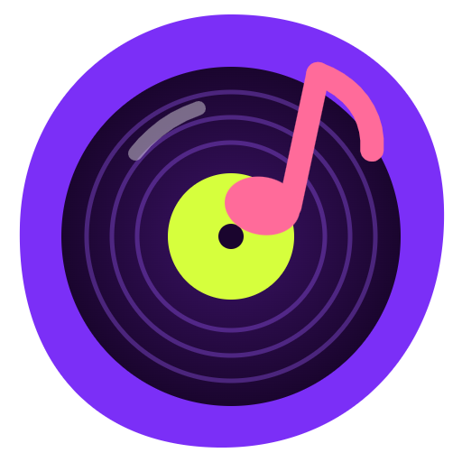
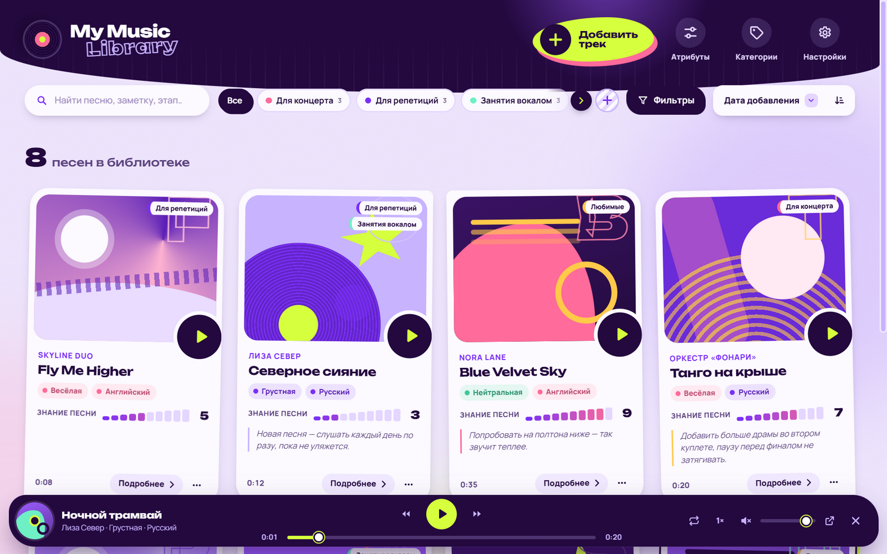
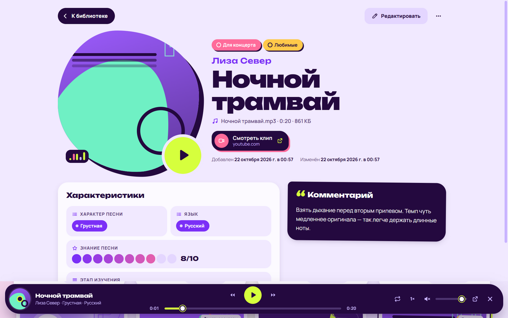
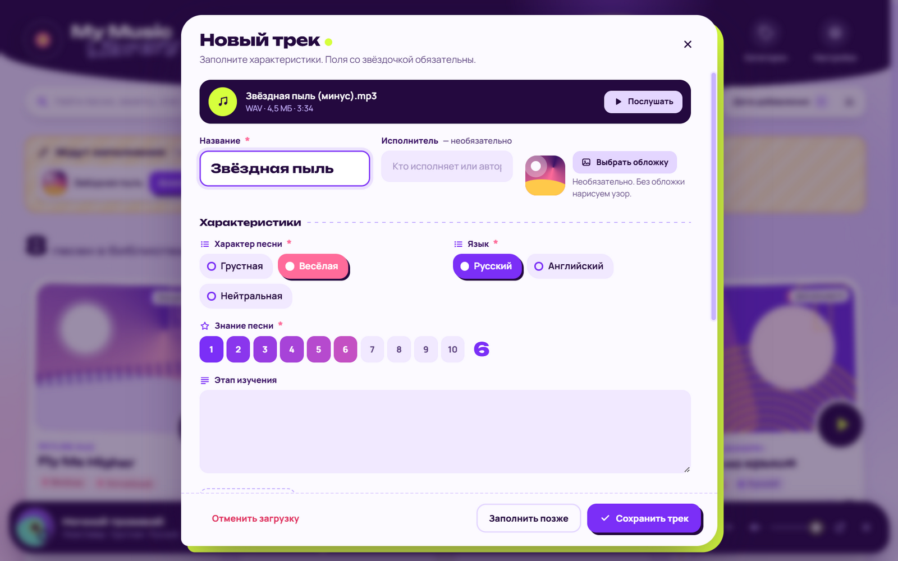
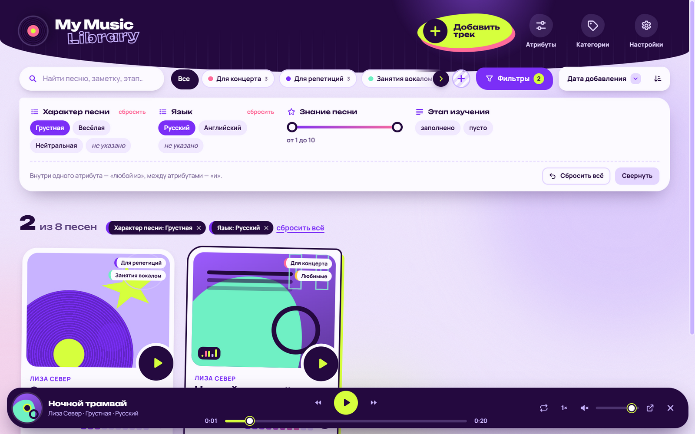
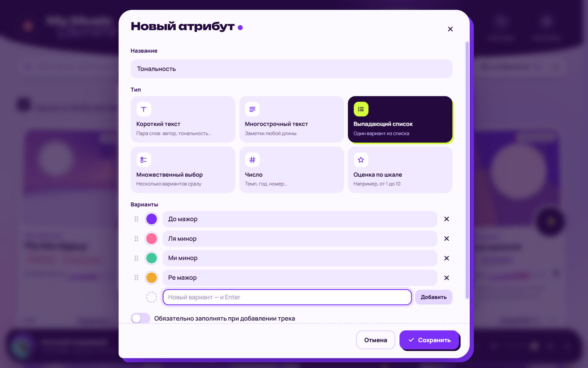
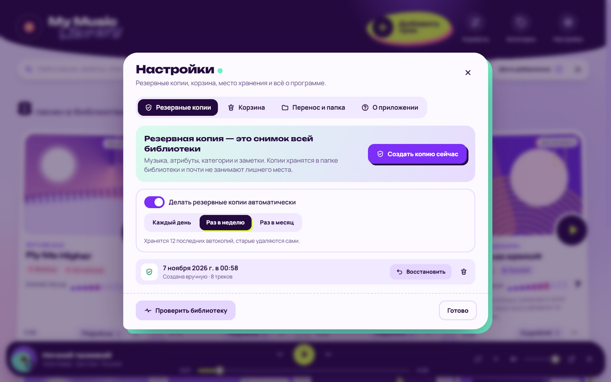
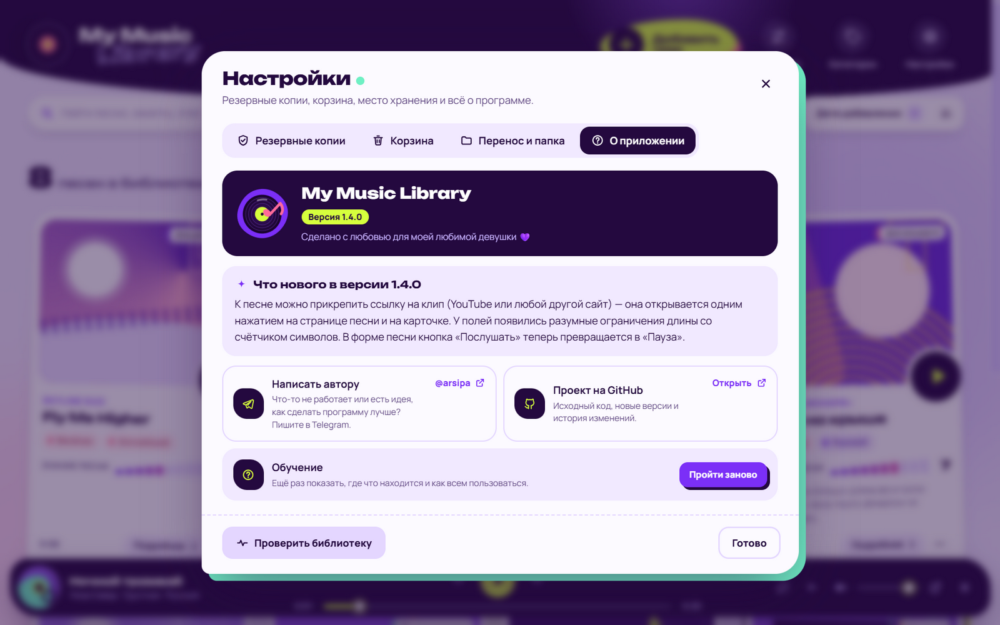
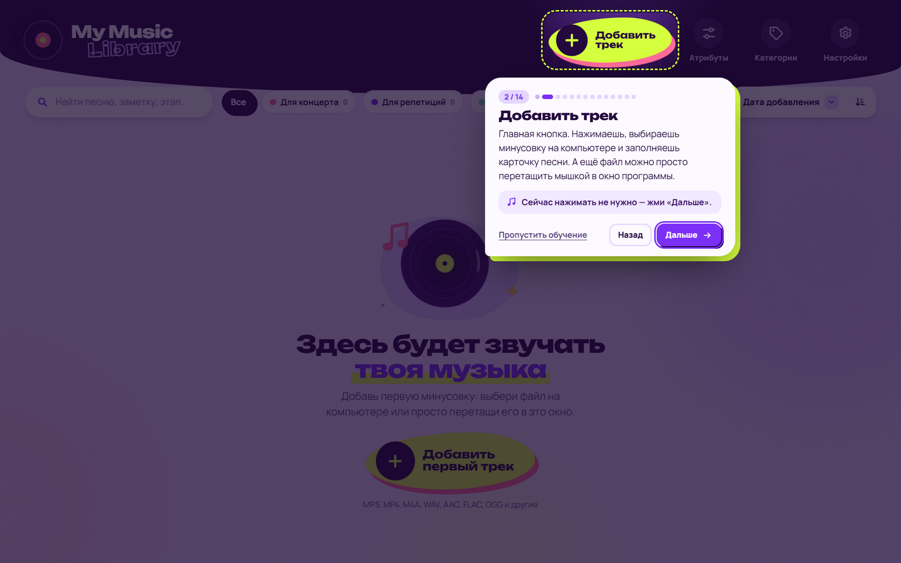
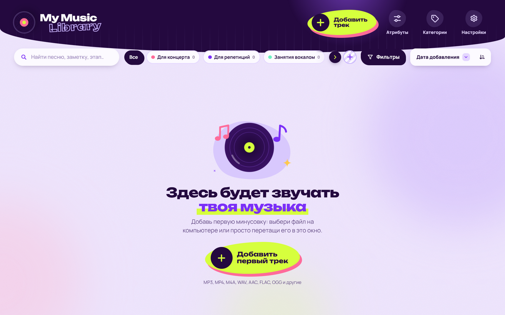

<div align="center">



# My Music Library

**Личная библиотека минусовок для тех, кто поёт.**<br>
Храни минусовки, отмечай, насколько выучена песня, пиши заметки к репетициям и находи нужный трек за секунду.


💜 *Сделано с любовью для моей любимой девушки — полностью с помощью Claude.*



</div>

## Что умеет

| Возможность | Подробнее |
|---|---|
| 🎵 **Минусовки любых форматов** | MP3, MP4 (с видео), M4A, WAV, AAC, FLAC, OGG, OPUS, WEBM. Добавление кнопкой или перетаскиванием файла в окно. |
| 🎤 **Исполнитель отдельно** | Своё поле для исполнителя: поиск и сортировка по нему, из имени файла «Исполнитель - Название» заполняется само. |
| 🎬 **Ссылка на клип** | К песне можно прикрепить ссылку на YouTube или любой сайт — она открывается одним нажатием. |
| 🏷️ **Свои характеристики** | Характер песни, язык, уровень знания, этап изучения — и любые свои: тональность, темп, текст песни. Новую можно создать прямо при заполнении карточки — она сразу появится у всех песен. |
| 🔎 **Поиск и фильтры** | Поиск по названию и заметкам, фильтры собираются сами из характеристик: «грустные, на английском, знаю на 7–10». |
| 📂 **Подборки** | «Для концерта», «Для репетиций», «Любимые» — одна песня может быть в нескольких. |
| 🎧 **Плеер для разучивания** | Повтор по кругу, замедление без изменения тона, перемотка с клавиатуры, просмотр видео. |
| 🛟 **Данные не потеряются** | Атомарная запись, корзина на 30 дней, резервные копии по расписанию, восстановление после сбоев. |
| 🎓 **Обучение при первом запуске** | Экран затемняется, нужная кнопка подсвечивается — как в играх. |
| 🔒 **Полностью локально** | Без серверов, облака, регистрации и интернета. Всё хранится на компьютере. |

## Как это выглядит

<table>
  <tr>
    <td width="50%"><br><sub><b>Страница песни</b> — все характеристики, заметки и плеер. Уровень знания меняется одним кликом.</sub></td>
    <td width="50%"><br><sub><b>Добавление песни</b> — обязательные поля отмечены звёздочкой, можно «заполнить позже».</sub></td>
  </tr>
  <tr>
    <td><br><sub><b>Фильтры</b> — строятся автоматически из характеристик песен.</sub></td>
    <td><br><sub><b>Конструктор характеристик</b> — шесть типов полей, без программирования.</sub></td>
  </tr>
  <tr>
    <td><br><sub><b>Настройки</b> — резервные копии по расписанию, корзина, перенос на флешку.</sub></td>
    <td><br><sub><b>О приложении</b> — версия, что нового, связь с автором и повторное обучение.</sub></td>
  </tr>
  <tr>
    <td><br><sub><b>Обучение</b> при первом запуске — подсвечивает, куда нажать.</sub></td>
    <td><br><sub><b>Первый запуск</b> — пустая библиотека.</sub></td>
  </tr>
</table>

## 💜 Об этом проекте

Это личный проект, и у него две причины появиться на свет.

**Первая — моя любимая девушка.** Она занимается музыкой и постоянно работает с минусовками: какие-то песни
уже готовы к выступлению, какие-то только начинает разбирать, к каждой — свои заметки. Ей нужна была удобная
и красивая библиотека, где всё это лежит в одном месте и ничего не теряется. Эта программа сделана для неё —
с любовью, под её задачи и в фиолетовых цветах. Я её очень люблю.

**Вторая — обучение работе с нейросетями.** Весь проект — от технического задания до кода, дизайна,
автотестов, установщика и этого README — сделан полностью с помощью [Claude](https://claude.ai) от Anthropic.
Для меня это эксперимент: насколько далеко можно зайти с ИИ-ассистентом, если подробно описать, что нужно,
и довести продукт до состояния, когда им действительно пользуются каждый день.

Если программа пригодится и вам — пользуйтесь на здоровье. Вопросы и пожелания — в Telegram [@arsipa](https://t.me/arsipa)
(ссылка есть и в самой программе: «Настройки» → «О приложении»). История версий — в [CHANGELOG.md](CHANGELOG.md).

## Установка

1. Скачайте `MyMusicLibrary-Setup-<версия>.exe` со страницы [Releases](https://github.com/Arsipa/MyMusicLibrary/releases) (или соберите сами: `npm run dist`, см. ниже).
2. Запустите его — права администратора не нужны. Программа установится и сама откроется, на рабочем столе появится ярлык.
3. Windows может показать окно SmartScreen, потому что установщик не подписан: «Подробнее» → «Выполнить в любом случае».

Новая версия ставится поверх старой: прошлая удаляется автоматически, песни и заметки остаются.
Пошаговая инструкция простым языком — в [README.txt](README.txt).

## Лицензия

[MIT](LICENSE) — программой можно свободно пользоваться, копировать, изменять и распространять,
в том числе в своих проектах; нужно лишь сохранять текст лицензии. Программа предоставляется «как есть», без гарантий.

Встроенные шрифты [Unbounded](https://github.com/googlefonts/unbounded) и [Manrope](https://github.com/sharanda/manrope)
распространяются по лицензии SIL Open Font License 1.1 (тексты лицензий — в `src/assets/fonts/`).

---

# Для разработчика

Оболочка — Electron, интерфейс — чистые HTML / CSS / JavaScript без фреймворков и сборщиков.

> Работаете с ИИ-ассистентом? Краткая карта проекта — в [AGENTS.md](AGENTS.md) (Claude Code подхватывает её через `CLAUDE.md`).

## Быстрый старт

Нужен [Node.js](https://nodejs.org) 20+ (проверено на 24).

```bash
npm install
node node_modules/electron/install.js   # только если npm заблокировал скачивание Electron (папки node_modules/electron/dist нет)
npm start                                # запустить программу из исходников
```

При запуске из исходников программа работает с той же папкой данных, что и установленная версия
(`%APPDATA%\My Music Library`). Для экспериментов лучше пользоваться автотестом — у него своя временная папка.

## Сборка установщика

```bash
npm run dist
```

Результат — `dist/MyMusicLibrary-Setup-<версия>.exe`. Рядом положите `README.txt` и передавайте пользователю эти два файла.

Установщик (NSIS, `oneClick`, без прав администратора):

- ставит программу в `%LOCALAPPDATA%\Programs\My Music Library` и создаёт ярлыки на рабочем столе и в «Пуске»;
- **сам удаляет предыдущую версию**: находит её по `appId` в реестре, тихо запускает её деинсталлятор
  с флагом сохранения данных и ставит новую в ту же папку. Две версии рядом не появятся;
- данные пользователя (`%APPDATA%\My Music Library`) не трогает ни при обновлении, ни при удалении.

## Ветки

- **`main`** — стабильная версия. Из неё собираются релизы, сюда попадает только проверенное.
- **`dev`** — разработка и проверка новых функций. Новое делается здесь (или в отдельной ветке от `dev`).

```bash
git checkout dev            # работать над новым
npm test                    # проверить
git checkout main
git merge dev               # когда всё готово и проверено — перенести в стабильную ветку
git push
```

## Выпуск новой версии

1. В ветке `dev` поднять версию в `package.json` (`"version": "1.3.0"`) — она попадает в имя установщика и в раздел «О приложении».
   Добавить запись в [CHANGELOG.md](CHANGELOG.md) и короткий текст (2–3 предложения) в `src/js/changelog.js` — его видно в программе.
2. `npm test` — все проверки должны пройти.
3. Слить `dev` в `main`, собрать: `npm run dist`.
4. Поставить тег и отправить: `git tag v1.3.0 && git push origin main v1.3.0`.
5. На GitHub: «Releases» → «Draft a new release» → тег `v1.3.0` → приложить `dist/MyMusicLibrary-Setup-1.3.0.exe`
   и `README.txt` → «Publish». Ссылку «Releases» из README пользователи увидят сразу.

**Никогда не меняйте** `build.appId` и `productName` в `package.json`:
по `appId` установщик находит старую версию, чтобы удалить её, а по `productName` программа находит папку
с данными пользователя. Если их поменять, получится вторая копия программы рядом со старой и «пустая» библиотека.

Если меняется формат данных — добавьте миграцию при загрузке (см. `Store.load` в `src/js/storage.js`,
там уже есть пример для настроек версии 1.0) и не удаляйте поля, которые могли быть сохранены раньше.

## Иконка

```bash
npm run icon      # перерисовывает build/icon.png из SVG в desktop/build-icon.js
```

## Автотесты

```bash
npm test
```

Запускает настоящее окно программы с отдельной временной папкой данных, проходит обучение, добавляет треки
(включая битый и неподдерживаемый файлы), проверяет плеер, фильтры, атрибуты, резервные копии, корзину, видео,
восстановление после повреждения JSON и что стартовый экран помещается на экран ноутбука.
Скриншоты — в `test/shots/`, итог — в `test/shots/result.txt`.

Скриншоты для этого README обновляются командой `npm run screenshots` (демо-библиотека во временной папке → `docs/screenshots/`).

Тестовые аудиофайлы создаются автоматически (`npm run test:media`), в репозиторий не попадают.
Тестовый хук включается только переменной `MML_TEST` и только в незапакованной программе.

## Устройство

```
desktop/
  main.js        главный процесс: окно, протокол mml:// (интерфейс + потоковое медиа с перемоткой), IPC
  preload.js     безопасный мост window.api для интерфейса
  storage.js     вся работа с диском: атомарная запись JSON, импорт файлов, корзина, копии, проверка целостности
  build-icon.js  генерация иконки
src/
  index.html
  css/           style.css (основа), cards.css, player.css, responsive.css (размеры окна)
  js/            util, ui (окна, меню), storage (состояние), attributes, categories, player, filters,
                 tracks, backup, dropdown, tour (обучение), app (главный экран и запуск)
  assets/fonts/  Unbounded и Manrope (встроены, интернет не нужен)
test/            e2e.js — автотест, screenshots.js — скриншоты для README, run-e2e.js — запуск, make-media.js — тестовые файлы
docs/screenshots/
build/icon.png
```

### Данные пользователя

По умолчанию `%APPDATA%\My Music Library\Library` (меняется в «Настройки» → «Перенос и папка»;
путь хранится в `%APPDATA%\My Music Library\config.json`).

```
Library/
├── data/            library.json, attributes.json, categories.json, settings.json (+ .prev — предыдущая версия)
├── storage/tracks/  минусовки (имя файла = уникальный id)
├── storage/covers/  обложки
├── storage/trash/   удалённые треки (30 дней)
└── backups/         резервные копии — полная копия структуры выше
```

- JSON пишется атомарно: временный файл → fsync → замена. Повреждённый файл никогда не перезаписывается —
  показывается экран восстановления.
- Плановые автокопии по умолчанию выключены; включаются в «Настройки» (каждый день / неделю / месяц).
  Страховочные копии перед восстановлением, импортом и удалением атрибутов делаются всегда.
  Автокопий хранится не больше 12.
- Музыка в копиях — жёсткие ссылки (NTFS), поэтому копии почти не занимают места. Файлы треков никогда
  не изменяются на месте, так что ссылки безопасны.
- Запускается только один экземпляр программы.
